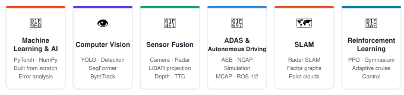
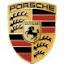

<h2>Vijay Mistry</h2>

  <strong>AI & Machine Learning Engineer · ADAS & Autonomous Driving</strong> 
  M.Eng. International Automotive Engineering · Technische Hochschule Ingolstadt, Germany

  
  &nbsp;
  

  
  &nbsp;
  
  &nbsp;
  

---

## 🧠 About me

AI and machine learning engineer focused on ADAS and autonomous driving, with industry experience at BMW, CARIAD, Kärcher and Porsche Engineering. I like taking a problem all the way from raw sensor data to a decision the vehicle can act on.

I build perception pipelines that fuse camera, radar and LiDAR, train detection and segmentation models in PyTorch, and turn their outputs into control, from a rule-based adaptive cruise controller to a PPO agent trained in Gymnasium. On the automotive side I have tested AEB functions against NCAP scenarios in simulation, debugged with MCAP logs, and written C++ and Python features on ROS 1/2 for autonomous robots.

My master's thesis at CARIAD was on landmark-based radar SLAM with factor graph optimization for assisted parking. Outside of that I enjoy rebuilding ML from first principles: a neural network in pure NumPy with manual backprop, a CNN with a hand-written training loop, and an SSD-style detector from scratch. Knowing what happens under the hood makes debugging a lot faster.

Away from the screen: volleyball, football and chess. The kind of person who enjoys a well-tuned control loop as much as a well-planned endgame.

📍 Munich, Germany · Open to relocating 
🌐 English C1 · German B2

## What I work on

## 💼 Experience

| | Role | Company |
|:-:|---|---|
|  | Intern: Driver Assistance Systems – Autonomous Emergency Braking (AEB) | BMW AG |
|  | Master Thesis: Landmark-Based RADAR SLAM Using Factor Graph Optimization for ADAS and Autonomous Driving | Volkswagen Group – CARIAD SE |
|  | Intern: Algorithm Development & Integration – Automated Driving | Alfred Kärcher SE & Co. KG |
|  | Intern: Software Function Development | Porsche Engineering Group |
|  | Studentische Hilfskraft (Student Research Assistant) | CARISSMA Institute (C-ECOS), TH Ingolstadt |

## 🚗 Featured projects

<table>
  <tr>
    <td width="65%">
      <h3>
        <a href="https://github.com/Vijayscodehub/Camera-Radar-Fusion-with-Object-Detection-Segmentation-for-Reinforcement-Learning-Based-ACC-">
          Camera–Radar Fusion for RL-Based Adaptive Cruise Control
        </a>
      </h3>
      

        Perception pipeline on nuScenes that combines YOLO object detection, SegFormer
        drivable-area segmentation and front-radar range/velocity to find the lead vehicle
        in the driving path and estimate its distance, relative speed and time-to-collision.
        Adaptive cruise control is solved two ways: a rule-based distance/TTC controller and
        a PPO agent trained for 50,000 timesteps in Gymnasium.
      

      

        
        
        
        
      

    </td>
    <td width="35%" align="center">
        
        
      
    </td>
  </tr>
</table>

<table>
  <tr>
    <td width="65%">
      <h3>
        <a href="https://github.com/Vijayscodehub/ML_pedestrian_detection_and_tracking">
          Camera–LiDAR Pedestrian Detection, Depth Estimation & Tracking
        </a>
      </h3>
      

        Detects pedestrians on KITTI Tracking with a fine-tuned YOLO11n, projects calibrated
        LiDAR points into the image to estimate each person's depth and 3D position, and keeps
        identities across frames with ByteTrack.
      

      

        
        
        
        
      

    </td>
    <td width="35%" align="center">
        
        
      
    </td>
  </tr>
</table>

<table>
  <tr>
    <td width="65%">
      <h3>
        <a href="https://github.com/Vijayscodehub/vehicle_detection_from_scratch">
          Vehicle Detection from Scratch 🚧
        </a>
      </h3>
      

        An SSD-style vehicle detector built from custom PyTorch components and trained on CPU:
        CNN backbone, anchor generation, IoU matching, box encoding, classification and
        Smooth L1 losses, hard-negative mining and non-maximum suppression. No pretrained
        backbones or ready-made detectors. The dataset is a curated 500-image BDD100K subset with
        written annotation guidelines and train/validation/test splits made by source video,
        so near-identical frames never leak between splits. Work in progress: annotation is
        underway and no validation or test results are reported yet.
      

      

        
        
        
        
      

    </td>
    <td width="35%" align="center">
        
        
      
    </td>
  </tr>
</table>

<table>
  <tr>
    <td width="65%">
      <h3>Automotive Perception for Automated Driving / ADAS</h3>
      

        Collective perception with a BMW test vehicle at the CARISSMA Institute, TH Ingolstadt.
        Collected real-world radar and camera object lists with a Perception Development Kit (PDK),
        processed and shared the sensor data between participants, and developed filtering algorithms
        that remove false-positive and false-negative detections to improve object detection.
        Results were visualized and evaluated in a virtual environment.
      

      

        
        
        
        
      

    </td>
    <td width="35%" align="center">
        
        
      
    </td>
  </tr>
</table>

---

## 🗂 Projects

| Project | Description | Result | Stack |
|---|---|---|---|
| [vehicle_detection_from_scratch](https://github.com/Vijayscodehub/vehicle_detection_from_scratch) | Custom SSD-style vehicle detector on CPU (anchors, IoU matching, losses, NMS) with a curated 500-image BDD100K subset, annotation guidelines and video-level splits | 🚧 Work in progress | PyTorch |
| [Supervised_learning_CIFAR10](https://github.com/Vijayscodehub/Supervised_learning_CIFAR10) | Hand-designed CNN, hand-written training loop, validation-only model selection, error analysis | **77.57%** test accuracy | PyTorch · TensorBoard |
| [numpy_mlp_fashion_mnist](https://github.com/Vijayscodehub/numpy_mlp_fashion_mnist) | Neural network in pure NumPy: manual backprop, SGD and a numerical gradient check | **82.81%** test accuracy | NumPy |
| [pytorch_mlp_fashion_mnist_project3](https://github.com/Vijayscodehub/pytorch_mlp_fashion_mnist_project3) | The same MLP rebuilt in PyTorch, mapping every manual step to autograd and optimizers | **81.83%** test accuracy | PyTorch |
| [automotive-ai-journey](https://github.com/Vijayscodehub/automotive-ai-journey) | Learning path from ML foundations to vision perception, an automotive RAG assistant and a multimodal capstone | Ongoing | Python |
| Modelling & Simulation of an Automotive Braking System | Physics-based Simulink model of vehicle and wheel dynamics with a hysteresis-based ABS controller, simulated with and without ABS | Shorter braking distance with ABS | MATLAB · Simulink |

---

## 🛠 Tech stack

**Languages**

**Machine learning & deep learning**

**Computer vision & perception**

**ADAS & robotics tools**

**Development**

---

## 📊 GitHub stats

---

## 🤝 Connect

&nbsp;&nbsp;

  

  Open to full-time roles in <strong>Machine Learning · Computer Vision · Perception · ADAS & Autonomous Driving</strong>. 
  LinkedIn or email are the best ways to reach me.

